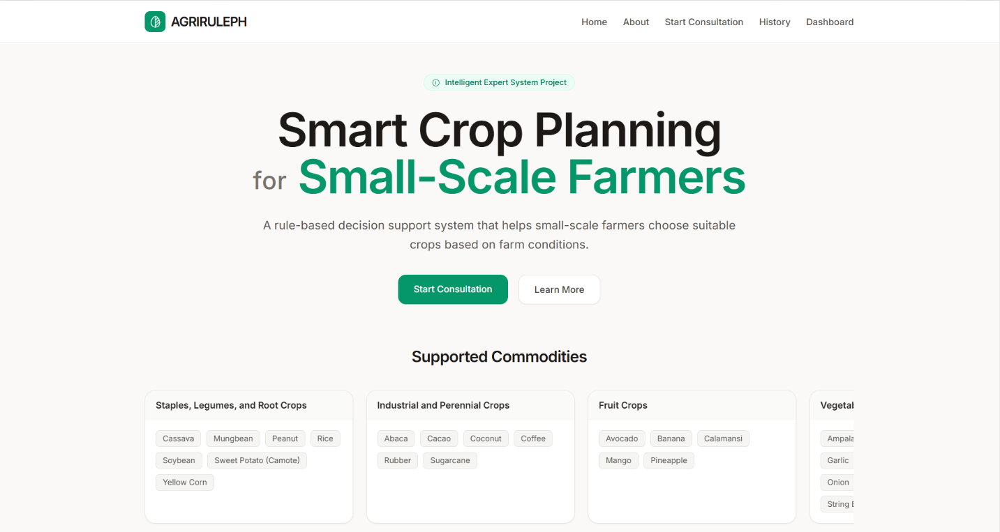
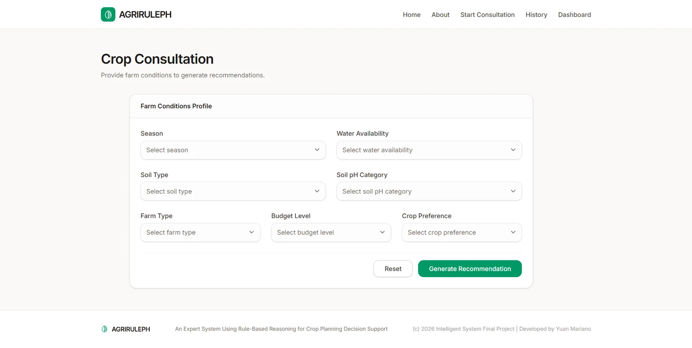
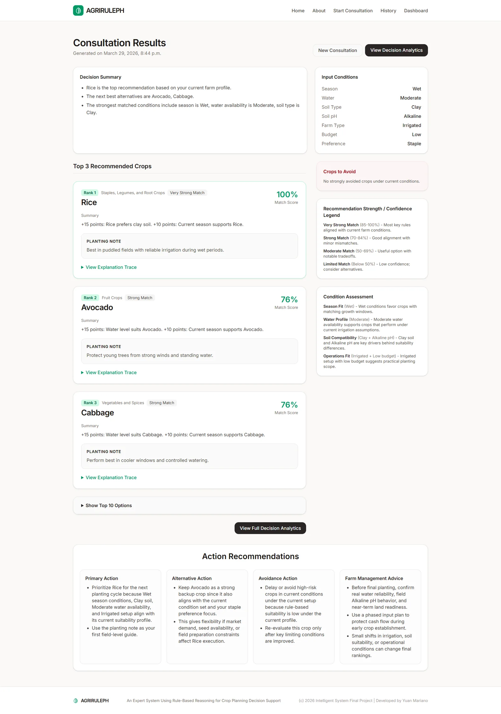
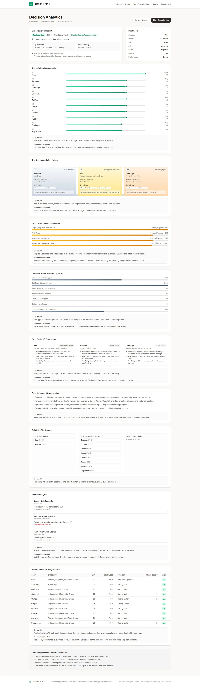
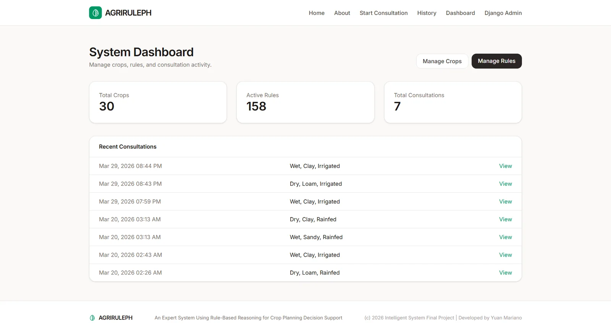

# AgriRulePH

[](https://agriruleph.vercel.app)    

Rule-based crop planning decision support for small-scale farmers in the Philippines.
Final project for **CS0065 Intelligent Systems** (FEU Institute of Technology, 3rd year, 2nd term, SY 2025-26).

**Live:** https://agriruleph.vercel.app &nbsp;|&nbsp; **Health check:** https://agriruleph.vercel.app/healthz/



## What it does

A farmer answers seven questions about their field. AgriRulePH evaluates them against a curated
**knowledge base of 30 crops and 158 IF-THEN rules** and returns:

- the top-ranked crops with a confidence label and a plain-language **explanation trace** (which rules fired and why),
- a **crops-to-avoid** panel with the reason for each warning,
- a **decision analytics** view: podium, category opportunity, per-factor match strength, what-if scenarios and trade-offs,
- a consultation **history** so earlier decisions can be revisited.

It is deliberately **not machine learning**. Every recommendation is deterministic and fully traceable to named rules,
which is the point of an expert system: a domain expert can read, challenge and edit the logic.

| Screen | Preview |
|---|---|
| Consultation |  |
| Results with explanation traces |  |
| Decision analytics |  |
| Staff dashboard (rule base CRUD) |  |

## How the inference engine works

The engine lives in [`expert_system/services/inference_engine.py`](expert_system/services/inference_engine.py).

**Facts (7 inputs):** season, soil type, water availability, farm type, soil pH, budget level, crop preference.

**Rules:** each rule belongs to one crop and has a condition per fact. A blank condition is a wildcard, so a rule matches
only when every non-blank condition equals the farmer's answer. Rules have a type:

| Type | Count in the shipped rule base | Effect when it matches |
|---|---:|---|
| `positive` | 120 | adds its score to the crop |
| `negative` | 30 | subtracts its score from the crop |
| `avoid` | 8 | subtracts `max(score, 50)` and flags the crop as *avoid* |

**Ranking:**

1. Sum matched rule scores per crop. Every matched rule's explanation is kept as the trace.
2. A crop is also flagged *avoid* when its final score is `<= -20` and at least one negative rule matched.
3. Crops are sorted by score; the top *N* non-avoid crops are recommended.
4. Scores are normalised to a 0-100 `score_percent` against the best recommended crop.
5. If too few non-avoid crops exist, the best available fallbacks are shown and an engine note says so.

The knowledge base covers four crop categories: vegetables and spices (12), staples/legumes/root crops (7),
industrial and perennial crops (6) and fruit crops (5).

## Architecture

```
core/            consultation flow, results, history, analytics API, health check, middleware, tests
expert_system/   models, inference engine, analytics + result-formatting services, seed command
dashboard/       staff-only CRUD for crops, rules and consultation records
templates/       Django templates (incl. standalone 503 page)
static/css/      Tailwind input/output and custom CSS
api/wsgi.py      Vercel serverless entry point
```

| Layer | Choice |
|---|---|
| Runtime | Python 3.12, Django 5.2 LTS |
| Database | PostgreSQL on **Neon**, AWS Asia Pacific 1 (Singapore), pooled connection |
| Hosting | Vercel (Python serverless function, WhiteNoise for static files) |
| Styling | Django templates + Tailwind CSS (CLI build) |

## Reliability

- **Fails fast:** database connections time out after `DB_CONNECT_TIMEOUT` seconds (default 5).
- **Fails readable:** a database outage returns a styled **503** page (or `{"error": "database_unavailable"}` for JSON endpoints)
  with `Retry-After`, instead of a bare 500. See `core.middleware.DatabaseUnavailableMiddleware`.
- **Health probe:** `GET /healthz/` returns `200 {"status": "ok"}` or `503 {"status": "degraded"}` for uptime monitors.
- **Observability:** every response carries a `Server-Timing` header (`dbfetch`, `inference`, `render`) and a JSON request log
  (`path`, `status`, `duration_ms`, `db_queries`, `db_time_ms`).
- **Performance guards:** history and dashboard pages are paginated with prefetching, and tests assert bounded query counts.

## Run locally

```powershell
git clone https://github.com/yuan05-afk/agrirule-ph.git
cd agrirule-ph
python -m venv .venv
.\.venv\Scripts\Activate.ps1
pip install -r requirements.txt
npm install
copy .env.example .env.local   # then edit values; leave DATABASE_URL empty to use SQLite
```

Load `.env.local` into the session and start the app:

```powershell
Get-Content .env.local | ForEach-Object {
  if ($_ -match '^\s*#' -or $_ -match '^\s*$') { return }
  $name, $value = $_ -split '=', 2
  [Environment]::SetEnvironmentVariable($name.Trim(), $value.Trim(), 'Process')
}
python manage.py migrate
python manage.py loaddata data_migration.json   # 30 crops, 158 rules, sample consultations, one staff user
npm run build:css
python manage.py runserver 127.0.0.1:8000
```

Prefer a fresh rule base? Run `python manage.py seed_initial_data` instead of `loaddata`, then
`python manage.py createsuperuser`.

Run the tests (they use an isolated SQLite test database):

```powershell
$env:DJANGO_DEBUG = '1'; $env:DJANGO_SECRET_KEY = 'test'
python manage.py test core
```

## Configuration

Copy [`.env.example`](.env.example). Never commit real values; `.env*` files are git-ignored.

| Variable | Purpose |
|---|---|
| `DJANGO_SECRET_KEY` | required whenever `DJANGO_DEBUG` is not `1` |
| `DJANGO_DEBUG` | `1` for local development only; defaults to off |
| `DJANGO_ALLOWED_HOSTS` | comma-separated hosts |
| `DJANGO_CSRF_TRUSTED_ORIGINS` | comma-separated `https://` origins |
| `DATABASE_URL` | PostgreSQL URL. Empty + `DJANGO_DEBUG=1` falls back to SQLite |
| `DB_CONN_MAX_AGE` | connection reuse in seconds (default 60 in production) |
| `DB_CONNECT_TIMEOUT` | seconds to wait for the database (default 5) |

## Deploy (Vercel + Neon)

1. Create a Neon project in **AWS Asia Pacific 1 (Singapore)** and copy the **pooled** connection string.
2. In Vercel, import this repository (the root directory is the repo root) and add the variables above for Production.
3. Set **Settings > Functions > Function Region to Singapore (sin1)**, next to the Neon database. This matters: with the default `iad1` every query crossed the Pacific and pages took 2-3.5 s; in `sin1` they take about 0.2-0.5 s. (`regions` in `vercel.json` is not honoured by this project's legacy `routes` config, so use the project setting.)
4. Build command: `npm install && npm run build:css && python manage.py collectstatic --noinput`
5. Seed the database once from your machine with `DATABASE_URL` set: `python manage.py migrate` then `python manage.py loaddata data_migration.json`.
6. Deploy, then confirm `/healthz/` returns `{"status": "ok", "database": "ok"}`.

Smoke test: Home, About, Consult, Results, History load; submitting a consultation persists and redirects;
`/results/<id>/analytics/data/` returns JSON; the staff dashboard paginates; admin login and rule CRUD work.

## Notes on the 2026-10 outage

The production site returned HTTP 500 on every page after the original Supabase project it used was removed
(`FATAL: (ENOTFOUND) tenant/user ... not found` from the pooler). The data layer was rebuilt on Neon Singapore from
`data_migration.json`, connection timeouts were shortened, and outages now degrade to a 503 page with a health probe.

## Project structure

```
agriruleph_project/   Django settings, URLs, WSGI
core/                 consultation flow, results, history, analytics API, health check, middleware, tests
expert_system/        models, inference engine, analytics + result-formatting services, seed command
dashboard/            staff-only CRUD for crops, rules and consultation records
templates/  static/   Django templates, Tailwind input/output and custom CSS
docs/                 screenshots and the course deliverables (report guides, flowcharts, pseudocode)
notebooks/            rule-engine demo notebook
api/wsgi.py           Vercel serverless entry point
data_migration.json   fixture: 30 crops, 158 rules, sample consultations, one staff user
```

## Team

Built for CS0065 Intelligent Systems by **Makayan Amorsolo, Isaac Manuel Batay, Yuan Andrei Mariano, Earl John Naranja and Raphael Edrian Tan** (FEU Institute of Technology). Deployment, the Neon/Vercel migration, the reliability work and this repository are maintained by [Yuan Andrei Mariano](https://github.com/yuan05-afk).

## Disclaimer

An educational decision-support prototype. Use it to support, not replace, local agriculture office guidance and expert advice.
