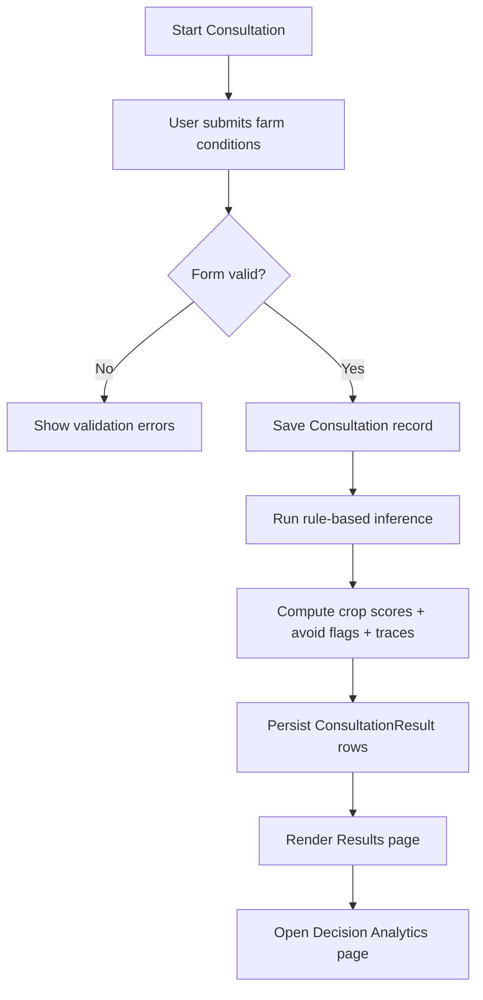
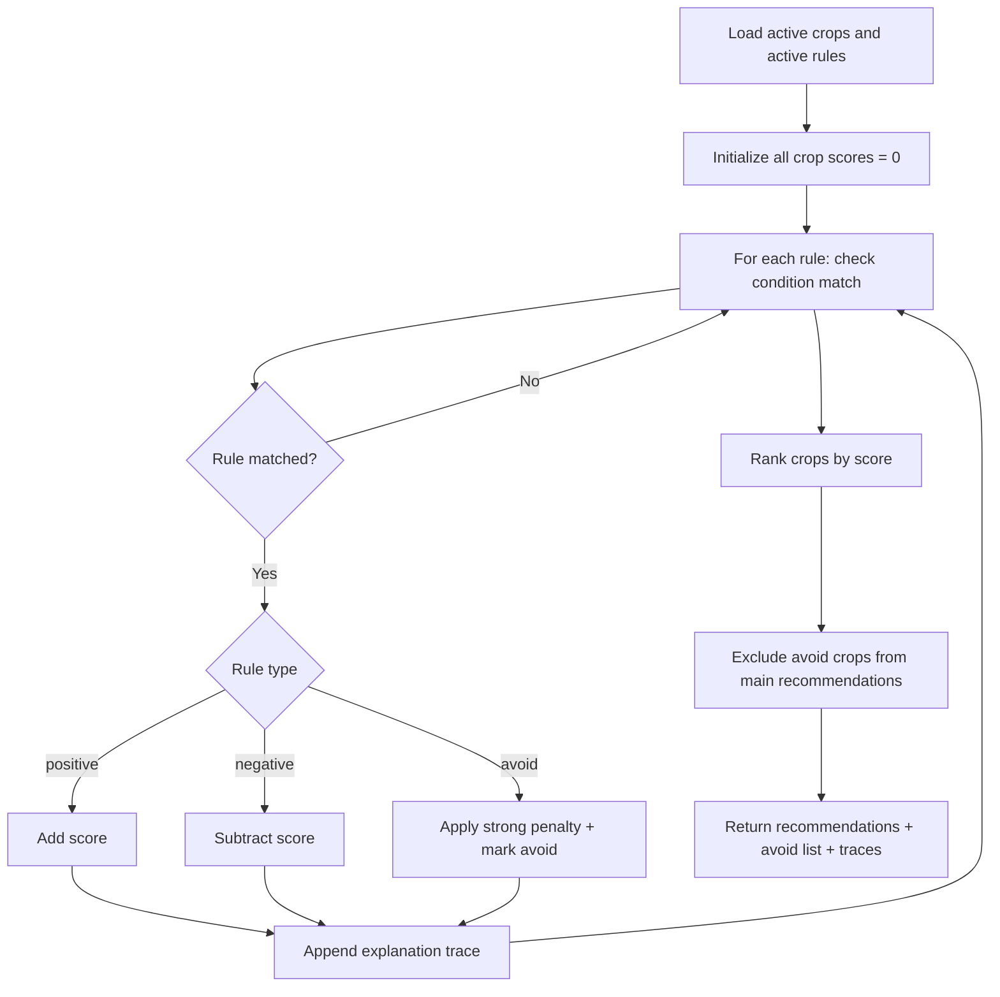
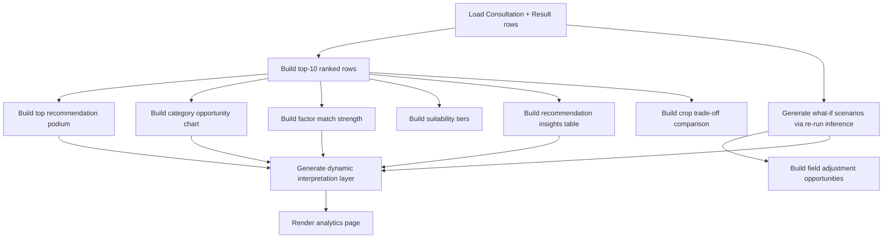

# 06. Architecture Diagram, Flowcharts, and Pseudocode

This document provides architecture and logic-flow artifacts for AgriRulePH.

## A. System Architecture Diagram (Mermaid)

```mermaid
flowchart LR
    U[Farmer/User] --> UI[Web UI<br/>Django Templates]
    UI --> V[core/views.py]
    V --> IE[Inference Engine<br/>run_inference()]
    V --> RF[Result Formatter]
    V --> AS[Analytics Service]

    IE --> DB[(MySQL / SQLite)]
    RF --> DB
    AS --> DB
    V --> DB

    DB --> M[Models:<br/>Crop, Rule,<br/>Consultation, ConsultationResult]
    M --> V

    A[Staff/Admin] --> D[Dashboard Views]
    D --> DB
    A --> DA[Django Admin]
    DA --> DB
```

## B. Consultation-to-Results Flowchart



## C. Rule Matching and Scoring Flowchart



## D. Decision Analytics Flowchart



## E. Core Pseudocode

### 1) Inference Engine (Simplified)
```text
function run_inference(facts, top_n=3):
    active_crops = get_active_crops()
    active_rules = get_active_rules_for_active_crops()

    scores = {crop_id: 0}
    avoid_flags = {crop_id: false}
    trace_map = {crop_id: []}

    for rule in active_rules:
        if rule_matches_facts(rule, facts):
            if rule.type == "positive":
                scores[rule.crop_id] += abs(rule.score)
            else if rule.type == "negative":
                scores[rule.crop_id] -= abs(rule.score)
            else if rule.type == "avoid":
                scores[rule.crop_id] -= strong_penalty
                avoid_flags[rule.crop_id] = true
            trace_map[rule.crop_id].append(rule.explanation)

    avoid_list = build_avoid_list(avoid_flags, scores, trace_map)
    ranked = rank_crops(scores, exclude_avoid=true)
    recommendations = ranked[0:top_n]

    return {
        recommendations,
        avoid_list,
        all_scores: scores,
        trace_map
    }
```

### 2) Consultation Flow (Simplified)
```text
on POST /consult:
    validate input form
    save Consultation
    inference = run_inference(cleaned_data)

    for each active crop:
        create ConsultationResult(
            score,
            explanation_text,
            is_recommended,
            is_avoid,
            rank_order
        )

    redirect to /results/<consultation_id>/
```

### 3) Analytics Interpretation Layer (Simplified)
```text
function build_interpretations(analytics_data):
    derive section-level summaries from:
      - top10 pattern
      - podium gaps
      - category dominance
      - factor strengths
      - what-if sensitivity
      - insights table indicators

    return {
      top10_key_insight,
      top10_recommended_action,
      ...
      table_key_insight,
      table_recommended_action
    }
```

## F. Notes for Report Use
- Copy diagrams into your report under Methodology/System Design.
- If Mermaid rendering is unavailable in your editor, export diagrams using a Mermaid live renderer and insert as images.
- Keep pseudocode synchronized with actual service code before final submission.
